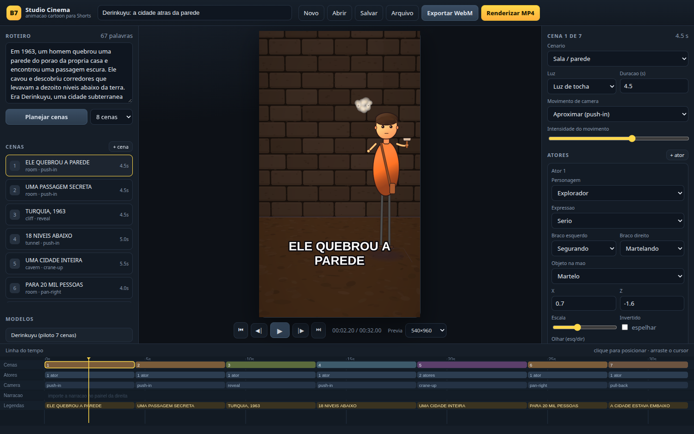
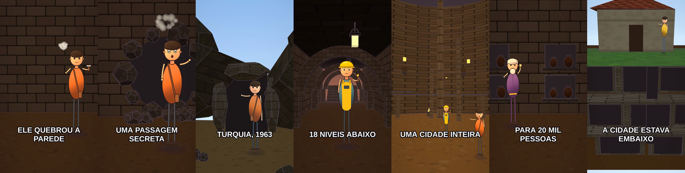

# B7 Studio Cinema

Estúdio gratuito, offline e estático para transformar um roteiro em português em um **Short animado vertical (9:16)** — com personagens cartoon 2D sobre cenários 3D cinematográficos, câmera, legendas, áudio e exportação para MP4.

Feito para o canal **B7 Histórias**, a partir do plano técnico `B7 Studio Cinema` e do `cartoon-short-kit`. Sem API paga, sem backend, sem conta.



## O que ele faz

- **Roteiro → cenas:** planejador por regras (não é IA generativa) propõe cenário, personagem, pose, legenda e duração para cada frase.
- **Editor visual:** 7 cenários 3D, 9 personagens, 15 expressões, 12 poses, 10 objetos, 10 movimentos de câmera, 7 paletas de luz e 5 efeitos.
- **Timeline:** cenas, atores, câmera, narração e legendas na mesma régua; clique posiciona o playhead.
- **Áudio:** importe voz e música; waveform, ducking e duração usada para fechar o tempo do vídeo.
- **Exportação:** WebM pelo navegador (revisão) e MP4 1080×1920/30 fps via renderizador local (Playwright + FFmpeg).
- **Projetos:** IndexedDB + JSON + pacote `.b7zip` com mídias.

## Começar

```bash
npm install
npm run dev          # http://127.0.0.1:5173
```

Para o MP4:

```bash
npx playwright install chromium
ffmpeg -version       # precisa estar no PATH
npm run render -- pacote.b7zip --video out/video.mp4
```

Guia completo: [docs/04_GUIA_DE_USO.md](docs/04_GUIA_DE_USO.md).

## Piloto incluído

**Derinkuyu: a cidade atrás da parede** — 7 cenas, 32 s, 1080×1920.



| Cena | Tempo | Cenário | Câmera | Legenda |
|---|---|---|---|---|
| 1 | 0–4,5 s | Sala / parede | push-in | ELE QUEBROU A PAREDE |
| 2 | 4,5–9 s | Sala com abertura | push-in | UMA PASSAGEM SECRETA |
| 3 | 9–13,5 s | Rochas / entrada | reveal | TURQUIA, 1963 |
| 4 | 13,5–18,5 s | Túnel com arcos | push-in | 18 NÍVEIS ABAIXO |
| 5 | 18,5–24 s | Caverna / cidade | crane-up | UMA CIDADE INTEIRA |
| 6 | 24–28 s | Depósito | pan-right | PARA 20 MIL PESSOAS |
| 7 | 28–32 s | Corte do subsolo | pull-back | A CIDADE ESTAVA EMBAIXO |

## Estrutura

```
src/engine/      pen (2D), cast (personagens), paint (texturas), world (cenários), camera, renderer
src/storyboard/  schema + normalizador + validador, planejador por regras
src/app/         player, timeline, inspector, store (IndexedDB), audio
local-renderer/  render.mjs (Playwright → RGBA → FFmpeg), encode.mjs (MP4 + QA)
 tests/           run.mjs (21 testes no Chromium)
docs/            análises, arquitetura, guia, QA e limitações
```

## Documentos

1. [Análise do canal Ricks Clips](docs/01_ANALISE_CANAL_RICKS_CLIPS.md) — 149 Shorts, duas fases, anatomia do formato de 60 s.
2. [Análise do pacote de planejamento](docs/02_ANALISE_DO_PACOTE.md) — o que o plano acerta, onde ele trava e o que foi decidido.
3. [Arquitetura](docs/03_ARQUITETURA.md) — modelo de dados, pipeline de render, desempenho, segurança.
4. [Guia de uso](docs/04_GUIA_DE_USO.md).
5. [QA e limitações](docs/05_QA_E_LIMITACOES.md) — testes, números medidos e o que não funciona.

## Estado

- 21/21 testes automatizados aprovados.
- Preset adicional `piscina-noturna`: piscina, luzes âmbar, patinho, telefone e microanimações determinísticas.
- Piloto renderizado em 1080×1920 (MP4 H.264 + AAC quando há narração).
- Limitações declaradas: sem TTS, sem sincronia labial, sem desfazer, sem transições entre cenas.

## Licença

Código deste repositório: **MIT**. Dependências: `three` (MIT), `fflate` (MIT), `pngjs` (MIT), `vite` (MIT), `playwright` (Apache-2.0). O `cartoon-short-kit` original é de `mromidev/claude-animated-shorts` (MIT) e foi usado como **referência de técnica**, não copiado: a camada 2D ausente (`toon.js`) foi reconstruída em `src/engine/pen.js` e `src/engine/cast.js`.
