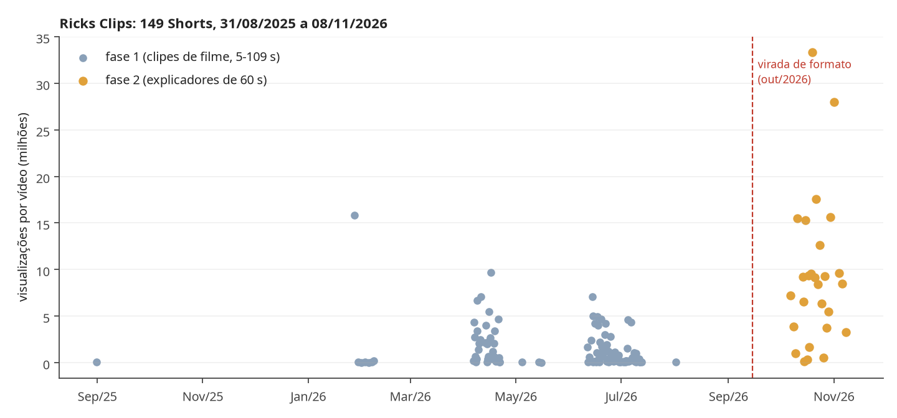
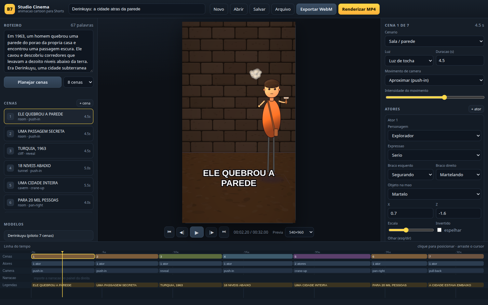
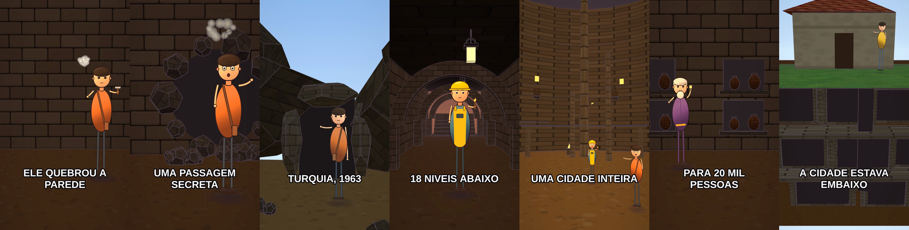

# Relatório geral — canal, pacote de planejamento e estúdio funcionando

**Data:** 10 de novembro de 2026
**Entregas:** análise do canal Ricks Clips · análise crítica do pacote B7 Studio Cinema · aplicativo implementado e testado (piloto Derinkuyu em MP4)

---

## 1. O que foi pedido

1. Analisar o canal `@RicksClips3000` (Shorts).
2. Analisar, com profundidade e leitura integral, o pacote `B7_Studio_Cinema_Planejamento_para_IA.zip`.
3. Implementar o que o pacote propõe, começando pela cena demonstrável — não por menus.

Os três foram feitos. A análise do canal e do pacote não ficou no papel: cada uma gerou decisões concretas no código.

---

## 2. Canal Ricks Clips: o que os dados mostram

149 Shorts entre 31/08/2025 e 08/11/2026, 167 mil inscritos, 427 milhões de visualizações somadas.

**A conclusão central:** o canal não cresceu por volume nem por consistência — cresceu por **virada de formato**, em outubro de 2026.

| | Fase 1 | Fase 2 |
|---|---|---|
| Período | 08/2025–09/2026 | 10/2026–11/2026 |
| Vídeos | 122 | 27 |
| Mediana de views | 483.922 | **8.496.319** |
| Duração mediana | 10 s | **60 s** |
| Formato | clipes de filme, loops, memes | explicadores de curiosidade e história |

Outros achados que importam para o B7:

- **Título é gancho, não descrição.** Mediana de 4 palavras; 20% com interrogação; "The X that Y" tem mediana de 15,3 M, "Why…" 9,2 M, "How…" 2,9 M.
- **O formato vencedor é uma mini-história de 60 s**, com corte a cada 1,5–2 s, personagem 2D sobre cenário 3D, legenda branca com contorno grosso e narração de contador de histórias. É exatamente a gramática que o `cartoon-short-kit` tenta industrializar.
- **Dez vídeos concentram 66% da audiência** — a distribuição é de cauda longa, e o piso do canal (mediana) é o que mudou.

O que **não** deve ser copiado: identidade, personagens, títulos e roteiros. O valor está na estrutura, não nos ativos.

Detalhamento completo, gráficos e checklist para os primeiros 10 vídeos: `01_ANALISE_CANAL_RICKS_CLIPS.md`.

---

## 3. Pacote de planejamento: o que ele acerta e onde ele trava

Lido integralmente (3 arquivos, 331 linhas), confrontado com o kit real (13 arquivos, 1.126 linhas).

**Acerta em:**
- separar site estático de renderizador local (GitHub Pages não roda FFmpeg);
- proibir "falsa IA" — heurística precisa ser chamada de heurística;
- critérios de aceite por fase e regra de não anunciar conclusão sem teste;
- piloto Derinkuyu com 7 tomadas e 25–30 s já descrito em batidas.

**Trava em três pontos:**
1. **A Fase 0 é inexequível como escrito.** O `engine/main.js` importa `./toon.js` e `./lib/three.module.js` — **nenhum dos dois existe no ZIP**; o `roman.js` depende de `Pen`, que viveria no `toon.js` ausente; o `story.js` está fora de `engine/`; e o `setup.sh` busca o código na internet, em Bash, sem versão fixada.
2. **"JSON validado por schema" sem schema.** O exemplo da seção 5 não comporta atores múltiplos, expressões, props, FX e SFX que o próprio plano exige.
3. **Nenhum número-alvo de desempenho**, apesar de o hardware ser conhecido e a Fase 6 mandar medir.

A resposta a esse tipo de plano não é obedecer literalmente nem reescrever do zero: é **fechar as lacunas com decisões explícitas, medir e entregar um vertical slice funcionando**. Foi o que aconteceu — a camada 2D ausente foi reconstruída (1.100 linhas), o schema foi escrito e versionado, e cada número que faltava foi decidido e documentado.

Análise completa, com evidências de código: `02_ANALISE_DO_PACOTE.md`.

---

## 4. O estúdio implementado

**Fluxo:** roteiro em PT-BR → planejador por regras → editor de cenas → timeline com áudio → WebM (revisão) ou MP4 1080×1920 (final).

**Números do produto:**

| Item | Quantidade |
|---|---|
| Cenários 3D paramétricos | 6 (sala, túnel, caverna, rocha, corte do subsolo, superfície) |
| Personagens | 8 |
| Expressões | 15 |
| Poses de braço | 11 |
| Objetos | 8 |
| Movimentos de câmera | 10 |
| Paletas de luz | 6 |
| Efeitos | 5 |
| Cenas do piloto | 7 (32 s) |

**Pipeline de render:** cartões 2D (canvas) posicionados em cena 3D → passe de cor com toon shading → passe de normal/profundidade → composição com contorno de tinta, saturação, calor, vinheta e conversão sRGB → legendas em canvas separado → captura RGBA → FFmpeg.

**Desempenho medido** (Linux sem GPU, SwiftShader — pior caso):

| Etapa | 540×960 | 1080×1920 |
|---|---|---|
| `renderFrame` | 17 ms | ~60 ms |
| pipeline completo | ~0,4 s/quadro | ~1,3 s/quadro |

**Testes:** 20/20 aprovados (13 de unidade, 7 de fumaça de render), incluindo "quadro não está preto", "seis cenas distintas" e "legenda na área segura".

**O que foi corrigido durante o desenvolvimento** (e que teria passado despercebido sem medição):

1. **Vídeo subexposto** — o passe de pós-processamento exibia valores lineares sem conversão para sRGB; o vídeo saía com média de 32/255. Correção: conversão explícita + exposição por paleta (hoje 44–93, conforme a cena).
2. **Captura 9× mais lenta que o render** — `toDataURL('image/png')` custava 0,9 s por quadro; trocado por RGBA cru para o FFmpeg.
3. **Personagens com cabelo cobrindo o rosto** e proporções de boneco — corrigido em três rodadas com folha de contato.
4. **Câmera dentro da geometria** no corte do subsolo, no túnel e na caverna.
5. **Poeira desenhada como nuvem com contorno**, parecendo um balão de fala — virou gradiente suave.

Detalhes técnicos: `03_ARQUITETURA.md`. Uso passo a passo: `04_GUIA_DE_USO.md`. Limitações e backlog: `05_QA_E_LIMITACOES.md`.

---

## 5. O que ainda não está pronto (sem rodeios)

| Limitação | Impacto | Caminho |
|---|---|---|
| Sem TTS | narração precisa ser gravada fora | Piper PT-BR instalável (P2) |
| Sem sincronia labial e sem legenda palavra a palavra | ritmo depende do corte | alinhamento por sílabas (P1) |
| Sem desfazer/refazer | edição fica frágil | histórico de projeto (P0) |
| Sem transições entre cenas | corte seco sempre | fade/wipe (P1) |
| Sem SFX embutidos | som precisa ser mixado fora | biblioteca livre + mixer (P1) |
| Desempenho no PC-alvo não medido | pode renderizar mais devagar que o sandbox | rodar `npm run render` no i3-7100 e registrar |
| Sem publicação | repositório pronto, Pages não ativado | enviar ao GitHub e ligar o workflow |

---

## 6. Próximos passos recomendados

1. **Medir no PC-alvo** (i3-7100 + GTX 1050): `npm run render` em 540 e 1080, registrar tempo por quadro.
2. **Produzir 3 vídeos reais** com o estúdio (do roteiro ao MP4) para calibrar roteiro, ritmo e legendas antes de escalar.
3. **Fechar o P0**: desfazer/refazer e marcadores de áudio arrastáveis.
4. **Publicar** no GitHub Pages e medir retenção no YouTube Studio — o dado que o canal de referência não expõe.
5. **Só então** investir em TTS e alinhamento automático.
